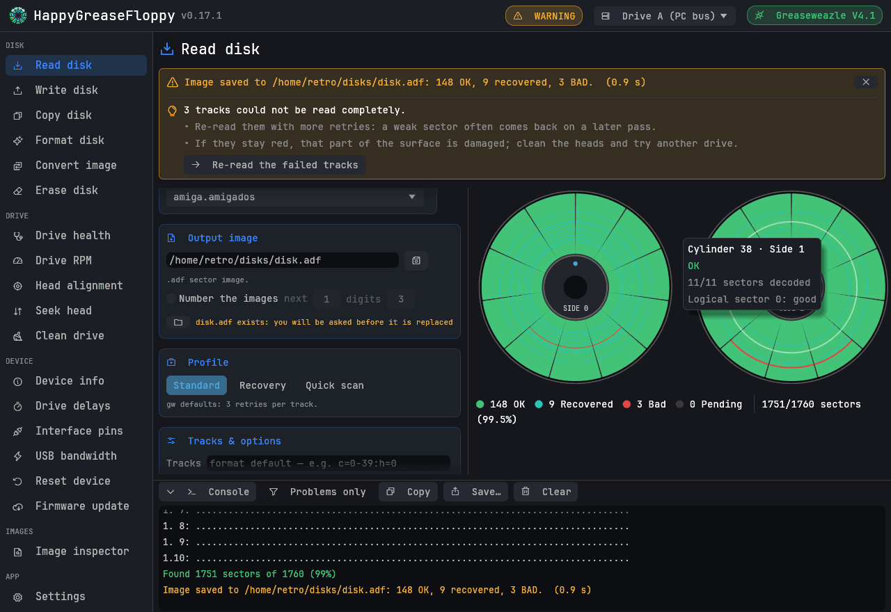
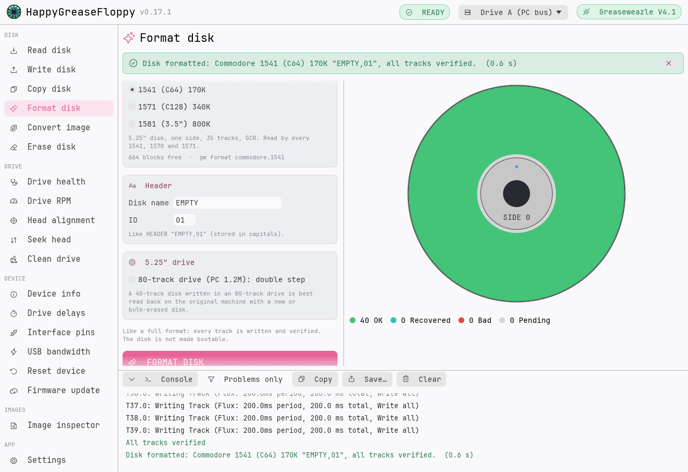
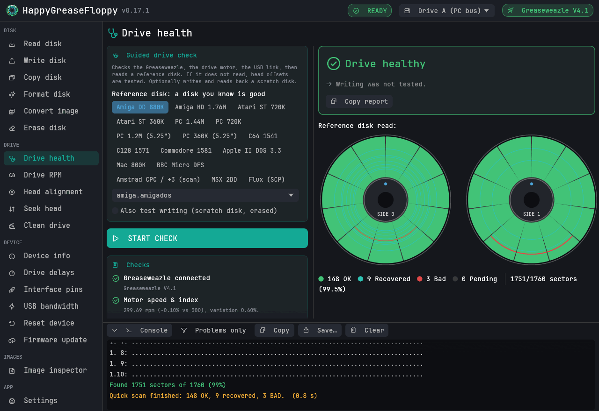
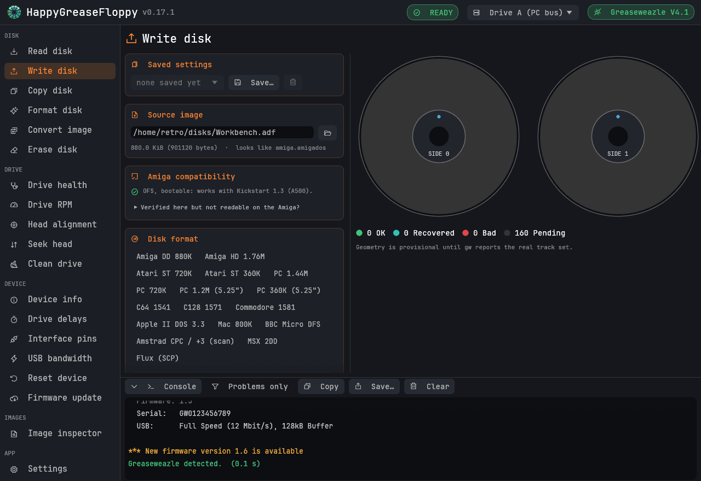
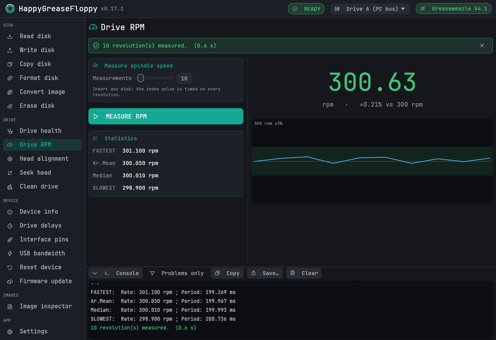
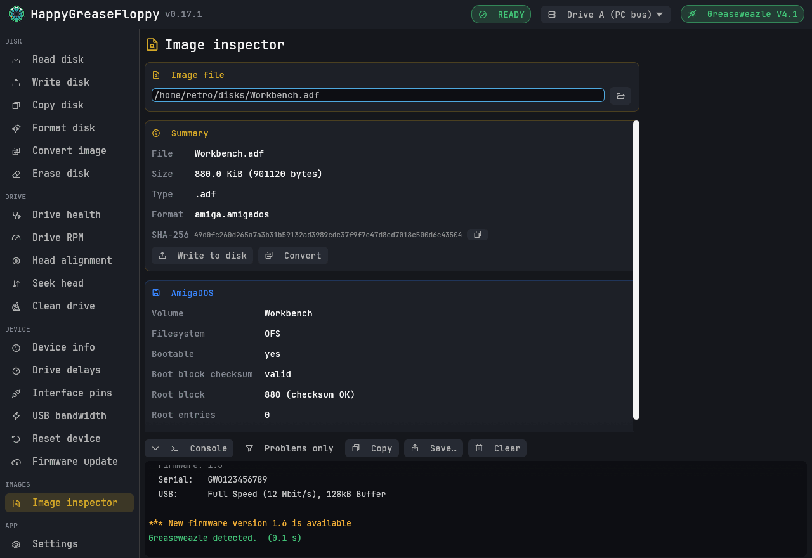

<p align="center">
  
</p>

<h1 align="center">HappyGreaseFloppy</h1>

<p align="center">
  <b>English</b> · <a href="README.fr.md">Français</a>
</p>

<p align="center">
  A friendly desktop front-end for the <a href="https://github.com/keirf/greaseweazle">Greaseweazle</a> floppy disk tools.<br>
  Read, write, copy, format and diagnose floppy disks — Amiga, PC, Atari ST, Commodore, Apple II, BBC Micro and more.<br>
  Windows · macOS · Linux — <b>v0.17.1</b>
</p>

<p align="center">
  
</p>

HappyGreaseFloppy drives the Greaseweazle host tools (`gw`) for you. It covers every `gw`
command, shows the disk track by track and sector by sector while it is read or written, explains
errors in plain language, and never runs a destructive operation without asking first.

*Formerly FluxMyFluffyFloppy.*

## Highlights

* **See the disk**: both sides drawn as rings of tracks, each track coloured as it is read or
  written (good, recovered after retries, bad), per-sector details on hover, progress with ETA.
* **Understand failures**: "No Index", "Track 0 not found", "Failed to verify", write protection,
  USB overflows… each comes with what to check and, when it helps, a button to the right tool.
* **Recover worn disks**: Recovery profile, then *Re-read the failed tracks* only.
* **Copy disks** with one drive (swap when asked) or two, as sectors or as raw flux (keeps copy
  protections).
* **Format** blank disks for Amiga, PC, Atari ST, MSX, Commodore 1541/1571/1581, BBC Micro and
  Apple II.
* **Check a drive** in one go: motor speed, USB link, a reference read (with a head-offset test
  if it fails), optional write test, and a verdict.
* **Archive a box of disks**: automatic numbering (`disk_001.adf`, `disk_002.adf`…), saved
  settings per machine, a log file of every command.
* Dark, light or system theme; adjustable text size; the exact `gw` command shown before it runs
  (Read, Write, Convert, Erase).

## Screenshots

| | |
|---|---|
|  |  |
| **Format disk** — a blank Commodore 1541 disk, written and verified (light theme) | **Drive health** — guided check with a verdict |
|  |  |
| **Write disk** — with the Amiga compatibility check | **Drive RPM** — speed, deviation and history |
|  | |
| **Image inspector** — size, SHA-256, AmigaDOS explorer | |

## Supported disks

**Reading, writing, copying and converting** work with every format and image type your
installed `gw` supports (about 150 formats: Amiga, PC, Atari, Commodore, Apple, Acorn, Amstrad,
MSX, Mac, PC-98, TRS-80…; ADF, IMG, ST, D64, DSK, HFE, SCP, IPF, KryoFlux and more). One-click
presets cover the common machines.

**Formatting** (blank disk built by HappyGreaseFloppy, then written and verified, or saved as an
image):

| Computer | Disks | Checked against |
|---|---|---|
| Amiga | DD 880K, HD 1.76M — OFS or FFS, International, volume name | amitools `xdftool` |
| PC | 360K, 720K, 1.2M, 1.44M, 2.88M — FAT12, volume label | mtools, dosfstools, pyfatfs |
| Atari ST | 360K single-sided, 720K double-sided (TOS) | mtools, dosfstools |
| MSX | 1DD, 2DD (MSX-DOS) | mtools, dosfstools |
| Commodore | 1541 (C64), 1571 (C128), 1581 — disk name and ID | VICE `c1541` (byte for byte) |
| BBC Micro | DFS 40 or 80 tracks, single- or double-sided, title | dfsimage |
| Apple II | DOS 3.3, ProDOS (data disks) | AppleCommander |

## Installation

No release is published: get the program in one of these two ways.

* **Build it** on your computer (a few minutes, see [Building](#building)).
* **Let GitHub build it**: in this repository, *Actions* → *Release* → **Run workflow**. When the
  run is finished (about 15 minutes), its page offers the three archives below under
  *Artifacts* (you must be signed in to GitHub to download them). Nothing is published.

The archives contain:

| System | Archive | How to start |
|---|---|---|
| Windows 10/11 | `…-windows-x86_64.zip` | Unzip and run `HappyGreaseFloppy.exe`. Unzip the official Greaseweazle tools release in the same folder: `gw` is then found automatically. |
| macOS 11+ (Apple Silicon and Intel) | `…-macos-universal.zip` | Unzip and move `HappyGreaseFloppy.app` to Applications. The app is not notarised: the first time, right-click → **Open**. Install `gw` with `pip3 install greaseweazle`. |
| Linux x86_64 | `…-linux-x86_64.tar.gz` | Extract and run `./install.sh` (current user, adds a menu entry). Install `gw` with `pip install --user greaseweazle`, and add yourself to the `dialout` group for USB access. |

**`gw` is found automatically**: configured path, `PATH`, the program's folder (and
`greaseweazle-*` sub-folders), Python user installs (`~/.local/bin`, pipx,
`~/Library/Python/*/bin`, Homebrew) and, on Windows, Python `Scripts` folders and
`greaseweazle-*` folders in Downloads, Desktop and Documents. *Settings → Auto-detect* searches
again; the `HGF_GW` environment variable forces a path.

## Getting started

1. **Connect** the Greaseweazle by USB and the drive with its ribbon cable and power.
2. **Choose the drive** in the top bar:
   * PC drive on a twisted cable: **Drive A** on the end connector (after the twist), **Drive B**
     on the middle one;
   * PC drive on a straight cable: **Drive B**;
   * Amiga, Atari or other vintage drive (straight cable): **Unit 0** or **Unit 1**.
3. **Check the setup** with *Drive health* and a disk you know is good.
4. **Read a disk**: pick the machine preset, the destination file, then *Read disk to image*. Red
   tracks can be read again with *Re-read the failed tracks*.
5. **Write a disk**: choose the image, check the format (detected from the image), then *Write
   image to disk*. Every track is verified.

Without hardware, start it with `HGF_GW=tools/fake-gw.py` (Linux, macOS; needs Python 3) to try
it against a simulator.

## Pages

| Page | `gw` command | What it does |
|---|---|---|
| Read disk | `read` | presets, profiles *Standard* / *Recovery* / *Quick scan*, all advanced options (revs, retries, PLL, fake index, flippy, densel…), disk numbering, image file options (HFE, SCP, KryoFlux) |
| Write disk | `write` | format detection, size check, pre-erase, verify retries, precompensation, Amiga compatibility check |
| Copy disk | `read` + `write` | one or two drives, sector or flux copy, bad source tracks reported before writing |
| Format disk | `write` | blank disks for the computers above; double step for 40-track disks in 80-track drives |
| Convert image | `convert` | between image types, track ranges, PLL, speed adjustment |
| Erase disk | `erase` | track range, revolutions, high-frequency erase |
| Drive health | `info` `rpm` `bandwidth` `read` `write` | guided check with a verdict and a copyable report |
| Drive RPM · Head alignment | `rpm` · `align` | live readouts and charts |
| Seek head · Clean drive | `seek` · `clean` | extreme-cylinder confirmation, cleaning progress |
| Device info · Drive delays · Interface pins · USB bandwidth | `info` `delays` `pin` `bandwidth` | device details and settings |
| Reset device · Firmware update | `reset` `update` | local file, GitHub tag, bootloader |
| Image inspector | — | size, SHA-256, guessed format, AmigaDOS explorer |

Also: saved settings (templates) on Read and Write, the `gw` command line with a copy button
under the action buttons, a *Stop* button (or `Esc`) for any running operation, a console with a
*problems only* filter, drag and drop of image files, an optional log file, and a taskbar/Dock
notification when a long operation ends in the background.

## Troubleshooting

| Message | Usual cause |
|---|---|
| `No Index` | No disk, or the drive does not turn: disk not inserted fully, drive not powered, wrong drive selected (A/B vs 0/1), cable upside down (drive LED always on). |
| `Track 0 not found` | Wrong drive selection or cable orientation (pin 1 at both ends). |
| `Failed to verify Track …` | Worn or wrong media (DD format on an HD disk: tape over the density hole), dirty heads. Try another disk, clean the heads, run *Drive health*. |
| Verified, but the Amiga cannot read it | See the *Amiga compatibility* card on the Write page: options left on (swap heads, double step…), FFS image on Kickstart 1.3, reused disk. |
| `Permission denied` (Linux) | Add yourself to the `dialout` group, then log out and back in. |
| macOS refuses to open the app | Right-click → **Open** the first time (the app is not notarised). |

The [Greaseweazle wiki](https://github.com/keirf/greaseweazle/wiki) covers the hardware side:
[getting started](https://github.com/keirf/greaseweazle/wiki/Getting-Started),
[troubleshooting](https://github.com/keirf/greaseweazle/wiki/Troubleshooting-FAQ),
[drive select](https://github.com/keirf/greaseweazle/wiki/Drive-Select).

## Building

Install [Rust](https://rustup.rs) 1.95 or later and a C toolchain (macOS:
`xcode-select --install`; Windows: *Build Tools for Visual Studio* with "Desktop development
with C++"; Linux: `gcc`), then:

```bash
cargo build --release -p hgf-gui
./target/release/happygreasefloppy          # target\release\happygreasefloppy.exe on Windows
```

* macOS application: `bash packaging/package.sh macos` → `dist/…-macos.zip` with
  `HappyGreaseFloppy.app`.
* Linux menu entry and icons: `packaging/linux/install.sh`.

Packaging, tests against reference tools, the icon and the release workflow are described in
[docs/DEVELOPMENT.md](docs/DEVELOPMENT.md). The version history is in
[CHANGELOG.md](CHANGELOG.md).

## Credits and licences

* [Greaseweazle](https://github.com/keirf/greaseweazle) hardware and host tools by Keir Fraser —
  HappyGreaseFloppy only runs `gw`, it does not include it.
* Inspired by [FluxMyFluffyFloppy](https://github.com/FrankieTheFluff/FluxMyFluffyFloppy), the
  Windows GUI by FrankieTheFluff (independent code).
* Built with [egui/eframe](https://github.com/emilk/egui) and
  [Phosphor icons](https://phosphoricons.com); text in
  [JetBrains Mono](https://www.jetbrains.com/lp/mono/) (SIL Open Font License 1.1, see
  `crates/hgf-gui/assets/fonts/JetBrainsMono-OFL.txt`).
* Third-party licences of every library: [THIRD-PARTY-LICENSES.txt](THIRD-PARTY-LICENSES.txt).

HappyGreaseFloppy itself has no licence yet: it is a personal project, all rights reserved by
its author.
